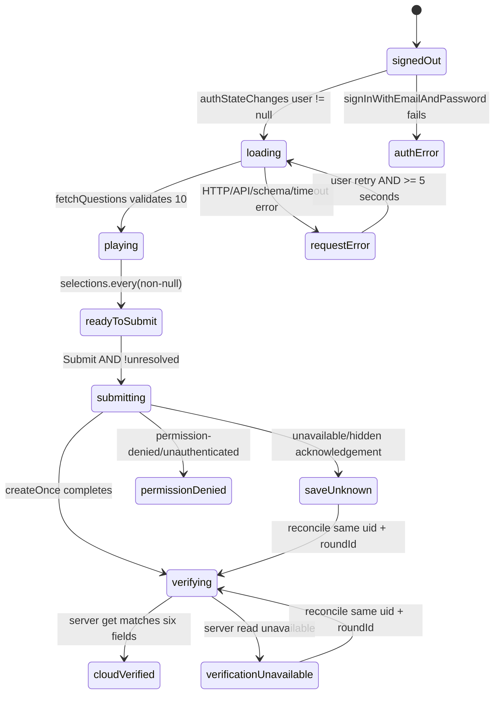

# ICA16 A Graduate Evidence — [Your Name]

Complete every bracketed item from real deployed-cloud tests. Do not claim a pass without observing it. Export the finished document as `ICA16_A_YourName.docx`.

## Build record and AI disclosure

- Student / level: [name], Graduate
- Device / OS: [device and version]
- Tested APK: [filename]
- Final commit: [hash]
- Firebase project alias (non-secret): [value]
- Test date/time and time zone: [value]
- AI disclosure: OpenAI Codex assisted with scaffolding, implementation, tests, and documentation on 2026-11-16. I reviewed the code and performed the recorded cloud tests myself.

## Four checkpoints

| Phase | Commit | Outcome | Failed-first correction / evidence |
|---|---|---|---|
| 1 API/model | `3ef8118` | Exact request, schema checks, decoded stable choices | [real observation/ref] |
| 2 quiz/auth | `f4191fa` | Sign-in, one-answer scoring, review/replay | [real observation/ref] |
| 3 cloud | `76272c2` | Transaction, collision guard, server read, strict rules | [real observation/ref] |
| 4 delivery | [final hash] | Setup, evidence, validation | Flutter scaffold initially [record actual result] |

## Actual state diagram



Guards use `unresolved`, `initiatingUid`, `initiatingRound`, `roundId`, and `FirebaseAuth.instance.currentUser?.uid`. Sign-out and replay are disabled while unresolved.

## Graduate concurrency sequence

```mermaid
sequenceDiagram
  participant A as Client A
  participant F as Firestore transaction
  participant B as Client B
  A->>F: get same roundId (absent)
  B->>F: get same roundId (absent)
  A->>F: set frozen payload; commit
  F-->>B: retry callback; get existing
  B->>F: compare five fields
  F-->>B: matching reuse OR collision, never overwrite
  A->>F: Source.server get
  B->>F: Source.server get
```

## Test log

For each row add precondition, timestamp, app commit, action, expected result, observed result, pass/fail, screenshot/log reference, and only a redacted round suffix.

| ID | Precondition/action | Expected | Observed | P/F | Evidence |
|---|---|---|---|---|---|
| T01 | Valid then invalid sign-in | UID or visible error; no secrets logged | [ ] | [ ] | [ ] |
| T02 | Load exact Class A URL | 10 valid category 9/easy/multiple questions | [ ] | [ ] | [ ] |
| T03 | Inject bad JSON, nonzero code, nine results | Each blocks play; rate-limited retry | [ ] | [ ] | [ ] |
| T04 | Correct, incorrect, double tap | Decoded stable choices; one score change | [ ] | [ ] | [ ] |
| T05 | Finish then replay | 10 reviews; new round ID; reset | [ ] | [ ] | [ ] |
| T06 | Online submit and double tap | One document; timestamp; server match | [ ] | [ ] | [ ] |
| T07 | Restart; retrieve saved ID as same user | Original attempt from server | [ ] | [ ] | [ ] |
| T08 | Offline submit, reconnect | No false success; same-ID recovery | [ ] | [ ] | [ ] |
| T09 | `hideAcknowledgement` after real commit | `saveUnknown`; server reconcile; one doc | [ ] | [ ] | [ ] |
| T10 | User B reads/writes user A path | Both denied by deployed rules | [ ] | [ ] | [ ] |
| T11 | Score 11, extra field, update | All denied; original preserved | [ ] | [ ] | [ ] |
| T12 | Inject unavailable/resource-exhausted | Distinct UI; bounded retry; no success | [ ] | [ ] | [ ] |
| G01 | Two clients submit same ID/payload | Exactly one deployed document | [ ] | [ ] | [ ] |
| G02 | Same ID, different score | Collision; original preserved | [ ] | [ ] | [ ] |
| G03 | Delayed response after auth changes | Cannot update new user's UI | [ ] | [ ] | [ ] |

## Six core responses (120–180 words each)

1. **Two success layers.** Explain T02/T03: HTTP 200 only means transport success; OpenTDB code 0 is application success; schema validation then proves exactly ten playable Class A objects. Cite `QuestionService.fetchQuestions`, a line reference, and test evidence. [Write 120–180 words.]

2. **Unknown is not failed.** Follow T09 through `submitting → saveUnknown → verifying → cloudVerified`. A Future timeout/hide does not undo a commit. The UI can say saved only after the matching server-only read. Cite redacted suffix and screenshot. [120–180 words.]

3. **Retry identity.** Compare new-ID-per-retry duplication with one ID per round. Explain matching reuse and mismatched-score collision in `createOnce`. Cite G02. [120–180 words.]

4. **Cloud trust.** Rules prove ownership and schema, not that answers were honestly scored. Propose an authenticated server endpoint that holds correct answers, scores submissions, and enforces nonce/idempotency/replay controls. [120–180 words.]

5. **Critique the AI.** Prompt used: “Using a fictional six-field score schema, design recovery when a Flutter cloud write commits but its acknowledgement is lost. Avoid credentials.” Tool/date: OpenAI Codex, 2026-11-16. Short excerpt: “Keep one idempotency key and reconcile with a server read.” Claims tested: same ID prevents duplicates; server read resolves unknown. Limitation to discuss: a generic proposal may omit Firestore callback retries, stale-user guards, or server timestamp verification. Revised design: cite this app’s transaction and guards. [120–180 words.]

6. **Personal design defense.** Defend the icon + text + color feedback (not color alone), explicit cloud status messages, and manual bounded recovery. Cite one screenshot and a failed-first correction. [120–180 words.]

## Graduate analyses (150–220 words each)

1. **G01/G02 interleavings.** Use the sequence above and actual evidence to explain transaction retry, matching reuse, mismatched collision, and immutable original. [150–220 words.]

2. **Server-authoritative scoring.** Design an authenticated API with server-held questions/answers, expiring round nonce, idempotency key, atomic score creation, and replay protection. Address residual threats such as account sharing, client automation, endpoint abuse, and server compromise. [150–220 words.]

3. **Transaction vs backend endpoint.** Compare direct transaction latency and lower infrastructure with contention retries and client-visible rule limits; compare endpoint extra hop/operations/cost with centralized authority, audit, and idempotency. Ground the conclusion in G01/G02. [150–220 words.]

## Redacted cloud proof and restart instructions

- App screenshot showing `Cloud verified`: [insert]
- Firestore console showing same six fields and redacted path: [insert]
- Redacted path: `users/[uid-redacted]/attempts/…[six-char suffix]`
- Authorized grader steps: obtain credentials privately, sign in, use the documented saved ID/restart flow, and compare exact server document. [Add actual steps.]
- Confirm no passwords/tokens appear in this document: [yes/no]

## Final reproducibility checklist

- [ ] `flutter test` passes; release APK builds and is install-tested.
- [ ] Rules are deployed to the same Firebase project used by the APK.
- [ ] T01–T12 and G01–G03 contain real deployed observations.
- [ ] T06/T07/T09–T11 and graduate concurrency evidence are from deployed cloud.
- [ ] Six core responses and three graduate analyses meet word counts.
- [ ] Screenshots correlate via redacted suffix and include timestamp/commit.
- [ ] Repository is grader-accessible and contains no secrets.
